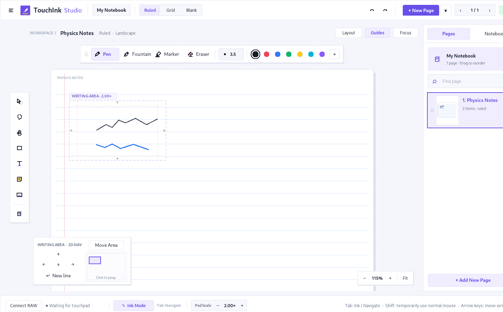

# TouchInk Studio

**Turn your Windows Precision Touchpad into a digital writing pad.**

TouchInk Studio is a local-first handwriting and note-taking app for compatible Windows precision touchpads. It reads raw, absolute touch coordinates so a finger or compatible capacitive pen tip can draw on a page without relying on normal mouse acceleration. You don't need a separate drawing tablet or a cloud account.



## Highlights

- **Absolute touchpad writing** with adjustable **Pad Scale (1–4×)** and a movable writing window.
- **Live Windows pointer tracking**: in Ink Mode, the actual mouse pointer follows the RAW touchpad writing position instead of a separate colored dot. No system mouse hook or driver modification.
- Pen, fountain pen, highlighter, true **vector ink eraser**, and freehand lasso selection.
- Lines, arrows, rectangles, ellipses and triangles, typed text, sticky notes and inserted images.
- Notebook pages, page thumbnails, drag-to-reorder, autosave and `.touchink` files.
- Ruled, grid or blank paper, in landscape or portrait orientation.
- Separate **Page Zoom (50–350%)** and Pad Scale, plus **2D writing-area navigation**: four arrow directions, drag-to-move and clickable mini page map.
- Export pages as PNG or SVG.
- **Focus Mode (`F11`)**, searchable page list (`Ctrl+F`), optional writing guides and a floating pen toolbar.
- A visual **New Page gallery** to choose a paper template and orientation.

## Requirements

- Windows 11 and a **Windows Precision Touchpad** whose driver exposes compatible HID contact reports.
- Python **3.10 or newer**, 64-bit, with Tkinter and `venv` available (Python 3.11–3.14 recommended).
- An ordinary finger or capacitive-compatible tip (a normal ballpoint nib generally will **not** register on a capacitive touchpad).

TouchInk does not replace or reconfigure your touchpad driver. Not all devices expose the raw data required for Absolute Mode.

## Install and run (Windows)

Download the project, or clone it:

```powershell
git clone https://github.com/Phoenixphan207/TouchInk-Studio.git
cd TouchInk-Studio
```

Then **double-click** the following batch files:

| File | Use |
| --- | --- |
| `INSTALL.bat` | Automatically detects a compatible installed Python, creates `.venv` and installs packages |
| `QUICK_START.bat` | **Recommended daily launch:** starts TouchInk without a console window; automatically installs on first use |
| `START.bat` | Opens the app with a console for diagnosing startup problems |
| `TEST.bat` | Runs core tests and syntax checks |
| `REPAIR.bat` | Reinstalls dependencies; backs up an unusable `.venv` before rebuilding |

Python 3.13 and other compatible versions are also detected automatically. The first installation needs an internet connection for Python packages. If the application fails to open, run `START.bat` and inspect `logs/launch.log`.

## Your first note

1. Launch TouchInk and click **Connect RAW**.
2. Verify that the status reports a compatible touchpad and test writing with a finger or capacitive tip.
3. Use **Pad Scale** to adjust how physical movement maps to the page. This is different from **Page Zoom**, which only changes what you see.
4. In **Ink Mode**, the **real Windows mouse cursor** follows each RAW pen contact at the corresponding point on the page. The software does not block mouse movement or clicks.
5. For toolbar clicks and normal touchpad navigation, press **Tab** to switch to **Navigate** (or temporarily hold **Shift** while touching the pad). Press **Tab** again to resume writing.
6. Move the writing area with **← / → / ↑ / ↓**, click the mini page map to jump to a new position, or switch to Navigate and **drag the paper** to move the writing frame. **Enter** starts a new line from the left margin.
7. AutoPan can move in all **four directions** when a directional stroke ends near the corresponding touchpad edge. It is optional.
8. Use **+ New Page** for a quick page, or the adjacent dropdown/**Templates** for ruled, grid and blank pages in landscape or portrait.
9. Notes are saved automatically. Use **Ctrl+S** to save immediately and the Notebooks panel to open existing files.

### Shortcuts

| Shortcut | Action |
| --- | --- |
| `Tab` | Switch Ink / Navigate (normal mouse) |
| Hold `Shift` | Temporarily pause RAW ink and pointer-follow to use the touchpad normally |
| `F8` or `Esc` | Switch to Navigate mode (no mouse lock to release) |
| `F11` | Toggle distraction-free Focus Mode |
| `Ctrl+F` | Find a page by name or text |
| `Ctrl+N` | Add a new page |
| `Ctrl+Shift+N` | Choose new-page template |
| `Ctrl+S` / `Ctrl+O` | Save / open notebook |
| `Ctrl+Z` / `Ctrl+Y` | Undo / redo |
| `1`–`4` | Pen / fountain pen / highlighter / eraser |
| `5` / `9` | Select / lasso |
| `6` / `7` / `8` | Shapes / text / pan |
| `←` / `→` / `↑` / `↓` | Move writing area left/right/up/down |
| `Enter` | New line (go down and return to left margin) |
| `Home` | Return to the left writing margin |
| `Shift` + mouse drag | Drag the writing window directly on the paper |
| `Delete` | Delete selected objects |

## Notebook storage and privacy

Notes are stored locally in your **Documents/TouchInk Studio** folder (unless you choose another path) using the `.touchink` JSON-based notebook format. This app does not upload your notes. Existing compatible `.touchink` notebooks remain openable.

## Important limitations

- RAW contact support depends on the touchpad hardware and driver. The app cannot force unsupported HID devices to expose coordinates.
- This is a **capacitive touchpad** workflow, not active stylus pressure/tilt hardware. Pressure sensitivity is not available from a basic passive tip.
- **No mouse interception:** The Windows touchpad driver still generates its normal pointer movement. In Ink Mode TouchInk updates the pointer to match RAW coordinates each frame; some devices may show brief pointer jitter. Press Tab or hold Shift when using the touchpad for interface controls.
- Cursor-follow only moves the pointer when TouchInk is the foreground window and the target is visible inside the canvas. This avoids sending the cursor to an off-screen location or another app.
- The app cannot turn an ordinary passive capacitive nib into pressure-sensitive pen hardware.
- The interface is built with **Python/Tkinter Canvas**, with custom vector icons and rounded controls. It runs locally, without Electron or a web service.

## Project files

`app.py` (desktop interface and interactions), `ui_icons.py` (vector icons), `engine.py` (ink and geometry), `ink_edit.py` (eraser/lasso), `raw_touchpad.py` (RAW HID), `cursor_follow.py` (Windows cursor mapping), `navigation.py` (2D writing-area movement), `notebook.py` (storage), `launcher.py` (startup and crash logs), and the batch launchers.

## Feedback

Report bugs or submit pull requests at [TouchInk-Studio](https://github.com/Phoenixphan207/TouchInk-Studio). Include your Windows version, touchpad model, the visible RAW status and reproducible steps. Do not upload private notebooks when filing a bug.

### Python detection troubleshooting

If setup cannot locate Python even though it is installed, open Command Prompt and run:

```bat
py -0p
python --version
```

The installer first checks for an existing working `.venv`, then searches installed Python versions through the Windows Python Launcher, and finally tries `python`/`python3` on `PATH`. It does **not** alter system Python or install drivers. To recover from a broken local `.venv`, run `REPAIR.bat`.
