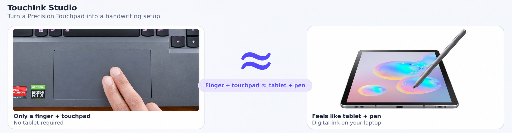

# TouchInk Studio

**Turn your Windows Precision Touchpad into a digital writing pad.**

TouchInk Studio is an open-source handwriting and note-taking app for Windows. It reads **absolute touch coordinates** from a compatible touchpad, so writing follows the position of your finger or capacitive pen tip instead of ordinary mouse movement.

Built for anyone who wants to take handwritten notes but doesn't have a drawing tablet, tablet computer, or dedicated digital pen. Inspired by the handwriting workflow of apps such as Scribble Ink, using the hardware already built into a laptop.

> **No drawing tablet required.** A compatible Windows touchpad and a capacitive tip are enough to get started.

## Features

- **Absolute touchpad writing** — maps touchpad contact positions directly to the writing area using RAW HID input, without mouse acceleration.
- **Writing Lock** — prevents accidental desktop mouse movement and clicks while writing; press **F8** to unlock.
- **Independent zoom controls** — adjust the touchpad-to-paper **Writing Scale** (1×–4×) separately from **Page Zoom** (50%–350%).
- **Writing-window navigation** — move left/right, start a new line, or use automatic advance after lifting near the right edge.
- **Ink tools** — pen, fountain pen, highlighter, adjustable colors and stroke thickness.
- **Ink-only eraser** — erases vector strokes without removing ruled lines, grids, or the page background.
- **Lasso selection** — circle multiple strokes and objects, delete them together, and undo the deletion.
- **Shapes and text** — lines, arrows, rectangles, ellipses, triangles, and text objects.
- **Notebook management** — create multiple pages, switch and rename pages, save and reopen `.touchink` notebooks, and autosave locally.
- **Paper styles** — ruled, grid, or blank; portrait and landscape layouts.
- **Export** — save a page as PNG or SVG, with Undo/Redo support while editing.

## Requirements



All you need to get started is:

- Windows 11 (with a compatible **Windows Precision Touchpad** exposing RAW HID contact coordinates)
- Python 3.11 or newer
- A finger or a capacitive / rubber-tipped stylus recognized by the touchpad

In other words: **finger + touchpad → tablet-like writing experience**.

**Compatibility:** RAW ABSOLUTE support depends on the touchpad hardware and driver. Not every Windows touchpad exposes usable reports. TouchInk Studio does **not** install, replace, or modify touchpad drivers.

## Installation

Clone the repository:

```bash
git clone https://github.com/Phoenixphan207/TouchInk-Studio.git
cd TouchInk-Studio
```

On Windows, run:

```bat
INSTALL.bat
START.bat
```

`INSTALL.bat` sets up the Python dependencies. `START.bat` launches the application. If the scripts are not found, make sure you are in the folder containing them.

Alternatively, download the project from [GitHub](https://github.com/Phoenixphan207/TouchInk-Studio) and extract it before running the scripts.

## Getting started

1. Launch **TouchInk Studio** and select **Connect RAW**.
2. Touch the laptop touchpad with a finger or capacitive pen tip. Confirm the app detects **RAW ABSOLUTE** input.
3. Choose a pen and write on the touchpad. Your strokes appear on the digital page.
4. Adjust **Writing Scale** to control how much of the page the touchpad covers. Adjust **Page Zoom** independently for comfortable viewing.
5. Enable **Writing Lock** to avoid accidental desktop interactions. Press **F8** at any time to release it.
6. Use the writing-window controls to continue across a line; add pages as needed. Notes are saved locally and can be reopened.

### Common shortcuts

| Shortcut | Action |
| --- | --- |
| `1` / `2` / `3` / `4` | Pen / Fountain / Highlighter / Eraser |
| `9` | Lasso selection |
| `Delete` | Delete selected objects |
| `←` / `→` | Move the writing window |
| `Enter` | Next writing line |
| `Ctrl + N` | New page |
| `Ctrl + S` / `Ctrl + O` | Save / Open notebook |
| `Ctrl + Z` / `Ctrl + Y` | Undo / Redo |
| `Ctrl + Mouse Wheel` | Zoom page view |

## How it works

```text
Capacitive contact on touchpad
             ↓
Windows Precision Touchpad / RAW HID
             ↓
Absolute contact coordinates (X, Y)
             ↓
Writing-area mapping + stroke smoothing
             ↓
Vector ink on the TouchInk canvas
             ↓
Notebook storage / PNG / SVG
```

Unlike ordinary touchpad mouse control, absolute mapping associates each touch position with a fixed location within the current writing window. This makes the touchpad behave more like a small graphics tablet. The app uses lightweight stroke smoothing; **it does not require AI or ML handwriting prediction**.

## Project structure

| File | Purpose |
| --- | --- |
| `app.py` | Desktop interface, tools, and interaction |
| `raw_touchpad.py` | Windows RAW HID touchpad input |
| `engine.py` | Ink geometry, mapping, smoothing, and export |
| `notebook.py` | Notebook serialization and persistence |
| `mouse_guard.py` | Writing Lock and emergency release |
| `INSTALL.bat` / `START.bat` | Windows setup and launch |
| `TEST.bat` | Run available tests |

Notebooks are typically stored in:

```text
%USERPROFILE%\Documents\TouchInk Studio\
```

## Limitations

- Requires a compatible Precision Touchpad and HID reports; some devices may not work.
- Standard capacitive tips do not provide active-stylus pressure sensitivity or palm rejection. Tip size and friction affect accuracy.
- Lasso selects whole ink objects, while the eraser can cut individual ink strokes. Erasing shapes or text removes the entire object.
- Performance and compatibility can vary across devices. Hardware-specific behavior has not been validated on every laptop.

## Feedback and contributions

Bug reports, compatibility findings, and contributions are welcome through [GitHub Issues](https://github.com/Phoenixphan207/TouchInk-Studio/issues) and [Pull Requests](https://github.com/Phoenixphan207/TouchInk-Studio/pulls).

When reporting a touchpad issue, include your Windows version, laptop/touchpad model, and the status shown after **Connect RAW**.

---

**Repository:** https://github.com/Phoenixphan207/TouchInk-Studio
